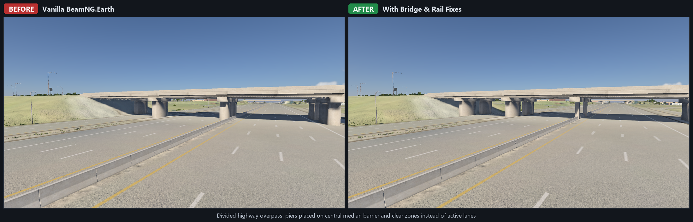
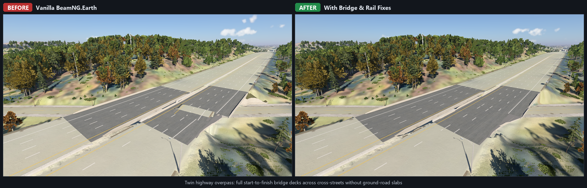

# BeamNG.Earth - Bridge, Rail & Tunnel Fixes

Fixes broken bridges, ramps, piers, divided highways, railway crossings, tunnel portals, multi-bore tunnel clearance, and lane transitions in **BeamNG.Earth**, and includes an optional **`Ctrl+Shift+B`** hotkey to flag bad spots while driving without pausing.

> **Work in Progress - Accelerated by Community Reports:** This add-on **does not fix every bridge, railway, and tunnel in the game**. Because **BeamNG.Earth** generates roads, bridges, railways, and tunnels across the entire world, this project is an active work in progress that is **accelerated by community bug reporting**. When you run into a broken bridge, overpass, railway crossing, or tunnel portal, press **`Ctrl+Shift+B`** while driving to report it so that structural pattern can be fixed in future updates.

## Global Coverage Snapshot

Census snapshot as of `v0.4.0` across `128 / 128` global map shards (`2026-11-25`):

| Category | Cataloged | Verified / Fixed | Archetypes Cleared | Coverage % |
| --- | ---: | ---: | ---: | ---: |
| Bridges | 5,838,327 | 1,337,074 | 28 / 91 | 22.90% |
| Railways | 1,934,028 | 1,588,597 | 33 / 51 | 82.14% |
| Tunnels | 1,177,424 | 456,109 | 29 / 92 | 38.74% |
| **Combined Total** | **8,949,779** | **3,381,780** | **90 / 234** | **37.79%** |

## Before & After

### Multi-Level & Truss Bridges
Separates stacked upper and lower highway decks instead of collapsing them together, and restores full 3D diagonal steel truss bracing.

### Highway Overpass Piers
Moves bridge columns onto central median barriers and clear zones instead of blocking active highway lanes.

### Divided Highway Overpasses & Ramps
Keeps elevated bridge decks and lane markings continuous across cross-streets and ramp forks without ground-road slabs cutting through the highway.

### Railways, Tunnel Portals & Multi-Bore Clearance
Preserves physically present heritage, electrified, and active railway tracks while suppressing converted collinear rail-trails across highways; seals open-mouth tunnel portal hoods, caps scree skirts below natural hillside lines, punches deep multi-bore portal throats cleanly, and prevents staggered or curved neighboring bores from clipping into adjacent driving lanes.

## Install - Option 1 (Inside BeamNG.Earth - Windows & Linux)

1. Open **BeamNG.Earth** -> **Add-ons** -> **Add from GitHub**.
2. Enter `CodeWMLandfill/BeamNG-Earth-Bridge-Rail-Fixes` and click **Install**.
3. Click **Start** on the add-on card, then close and restart **BeamNG.Earth**.

## Install - Option 2 (1-Click Setup - Windows & Linux)

- **Windows:** Download the [repository ZIP](https://github.com/CodeWMLandfill/BeamNG-Earth-Bridge-Rail-Fixes/archive/refs/heads/main.zip), right-click -> **Extract All...**, and double-click **`1_Click_Install.bat`** (or download `beamng_earth_bridge_rail_fixes.py` from [Releases](https://github.com/CodeWMLandfill/BeamNG-Earth-Bridge-Rail-Fixes/releases) and double-click it).
- **Linux (`x86_64`):** Download the [repository ZIP](https://github.com/CodeWMLandfill/BeamNG-Earth-Bridge-Rail-Fixes/archive/refs/heads/main.zip), extract it, and run **`./1_Click_Install.sh`** (or download `beamng_earth_bridge_rail_fixes.py` from [Releases](https://github.com/CodeWMLandfill/BeamNG-Earth-Bridge-Rail-Fixes/releases) and run `python3 beamng_earth_bridge_rail_fixes.py install`).
- Setup automatically finds **BeamNG.Earth** and your native **BeamNG.drive** user folder, backs up originals with SHA-256 verification, and offers to close and restart **BeamNG.Earth** if it is open.

## Uninstall

- **Inside BeamNG.Earth:** Open **Add-ons** -> **Options**, choose **`Restore original app`**, click **Save**, click **Start**, and restart **BeamNG.Earth**.
- **Standalone:** Double-click **`1_Click_Uninstall.bat`** on Windows, or run **`./1_Click_Uninstall.sh`** (`python3 beamng_earth_bridge_rail_fixes.py uninstall`) on Linux, to restore the original **BeamNG.Earth** byte-for-byte.

## Report a Bad Spot (`Ctrl+Shift+B`)

Press **`Ctrl+Shift+B`** anytime while driving to silently send a quick screenshot and map location without pausing the game. When a spot you reported is fixed in a later update, a quiet one-time corner notice lets you open the report or teleport straight there. You can change the default category (`bridge`, `rail`, `tunnel`, `road`, `other`), turn fix notices off, or disable the hotkey in **Add-ons -> Options**.

## Privacy

- No login, name, account, or personal info is collected.
- No PC usernames, folder paths, or IP addresses are stored.
- Hidden photo details (EXIF/metadata) are stripped before upload.

## Requirements

- **Windows 10 or 11** (`64-bit`) or **Linux** (`x86_64`, native **BeamNG.Earth** `AppImage` / source + native Linux **BeamNG.drive**).
- **BeamNG.Earth v1.9.1-beta.dev.424** through **v1.10.1-beta** and **v1.10.1-beta.dev.574** in full solver mode (`direct` or `server_v2`), with automatic forward-compatible client & reporter fallback for intermediate (`dev.567`) and newer `dev.*` builds including **v1.10.1-beta.dev.591** through **v1.10.1-beta.dev.595** (older versions are skipped safely with a clear notice).
