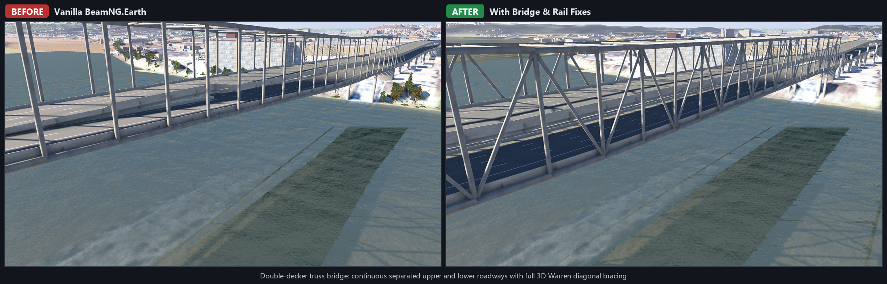

# BeamNG.Earth - Bridge & Rail Fixes

Fixes broken bridges, ramps, piers, divided highways, railway crossings, and lane transitions in **BeamNG.Earth**, and includes an optional **`Ctrl+Shift+B`** hotkey to flag bad spots while driving without pausing.

> **Work in Progress - Accelerated by Community Reports:** This add-on **does not fix every bridge and railway in the game**. Because **BeamNG.Earth** generates roads and bridges across the entire world, this project is an active work in progress that is **accelerated by community bug reporting**. When you run into a broken bridge, overpass, or railway crossing, press **`Ctrl+Shift+B`** while driving to report it so that structural pattern can be fixed in future updates.

## Global Feature & Archetype Completion Metrics

Global census snapshot and structural archetype verification across worldwide Overture Maps shards (`128 / 128` shards categorized, `100.0%`, snapshot at `2026-11-24T11:49:00Z`):

- **Global Shard Coverage:** `128 / 128` shards (`100.0%`) - **8,949,779** structures categorized worldwide
- **Archetype Elimination Progress:** `80 / 234` structural archetypes cleared (`1,771,578` structures eliminated by archetype, `1,164,947` directly verified clean)
- **Overall Feature Completion:** `2,936,525 / 8,949,779` (`32.81%`)

| Category | Categorized | Verified Clean | Archetypes Cleared | Completion % |
| --- | ---: | ---: | ---: | ---: |
| Bridges | 5,838,327 | 481,764 | 21 / 91 | 17.88% |
| Railways | 1,934,028 | 392,572 | 31 / 51 | 73.49% |
| Tunnels | 1,177,424 | 290,611 | 28 / 92 | 40.02% |
| **Combined Total** | **8,949,779** | **1,164,947** | **80 / 234** | **32.81%** |

## Before & After

### Multi-Level & Truss Bridges
Separates stacked upper and lower highway decks instead of collapsing them together, and restores full 3D diagonal steel truss bracing.

### Highway Overpass Piers
Moves bridge columns onto central median barriers and clear zones instead of blocking active highway lanes.

### Divided Highway Overpasses & Ramps
Keeps elevated bridge decks and lane markings continuous across cross-streets and ramp forks without ground-road slabs cutting through the highway.

## Install - Option 1 (1-Click ZIP)

1. Click the green **Code** button above -> **Download ZIP** (or [download the ZIP directly](https://github.com/CodeWMLandfill/BeamNG-Earth-Bridge-Rail-Fixes/archive/refs/heads/main.zip)).
2. Right-click the `.zip` file, click **Extract All...**, and open the extracted folder.
3. Double-click **`1_Click_Install.bat`**.
   - It automatically finds **BeamNG.Earth** on your PC and offers to close and restart it for you if it is running.

## Install - Option 2 (Inside BeamNG.Earth)

1. Open **BeamNG.Earth** -> **Add-ons** -> **Add from GitHub**.
2. Enter `CodeWMLandfill/BeamNG-Earth-Bridge-Rail-Fixes` and click **Install**.
3. Click **Start** on the add-on card, then close and restart **BeamNG.Earth**.

*(Tip: You can also download `beamng_earth_bridge_rail_fixes.py` from the [Releases](https://github.com/CodeWMLandfill/BeamNG-Earth-Bridge-Rail-Fixes/releases) tab and double-click it in File Explorer to launch the 1-click setup.)*

## Uninstall

- **From the ZIP folder:** Double-click **`1_Click_Uninstall.bat`** to restore the original **BeamNG.Earth** in one click.
- **Inside BeamNG.Earth:** Open **Add-ons** -> **Options**, choose **`Restore original app`**, click **Save**, click **Start**, and restart **BeamNG.Earth**.

## Report a Bad Spot (`Ctrl+Shift+B`)

Press **`Ctrl+Shift+B`** anytime while driving to silently send a quick screenshot and map location without pausing the game. When a spot you reported is fixed in a later update, a quiet one-time corner notice lets you open the report or teleport straight there. You can change the default category (`bridge`, `rail`, `road`, `other`), turn fix notices off, or disable the hotkey in **Add-ons -> Options**.

## Privacy

- No login, name, account, or personal info is collected.
- No PC usernames, folder paths, or IP addresses are stored.
- Hidden photo details (EXIF/metadata) are stripped before upload.

## Requirements

- **Windows 10 or 11** (64-bit).
- **BeamNG.Earth v1.9.1-beta.dev.424** through **v1.10.1-beta** and **v1.10.1-beta.dev.574** in full solver mode (`direct` or `server_v2`), with automatic forward-compatible client & reporter fallback for intermediate (`dev.567`) and newer `dev.*` builds (older versions are skipped safely with a clear notice).
